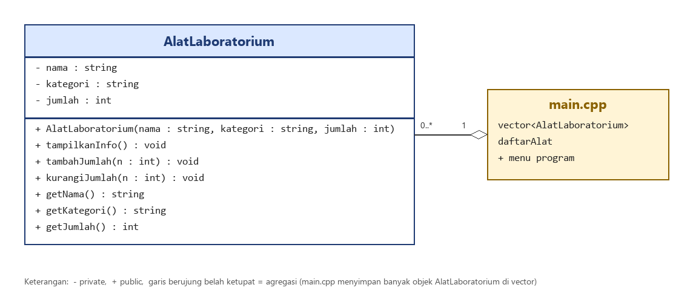
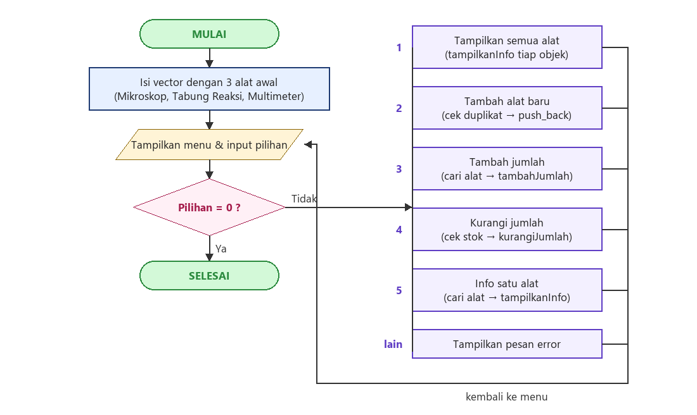
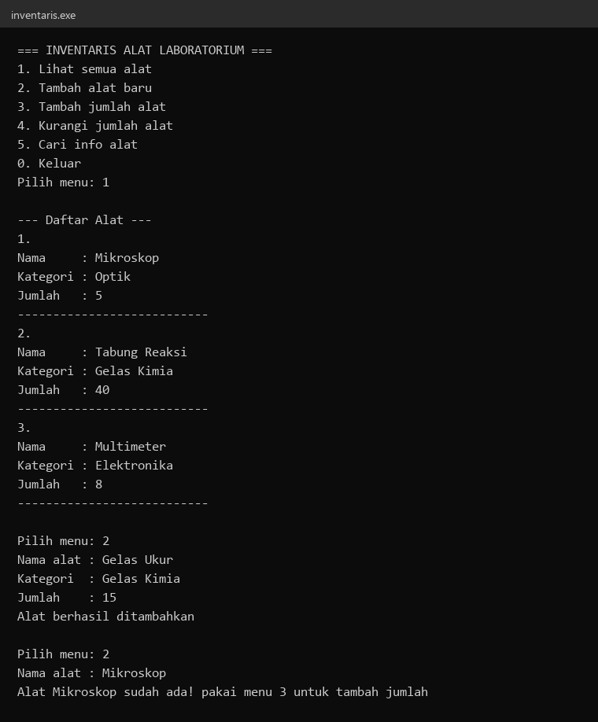
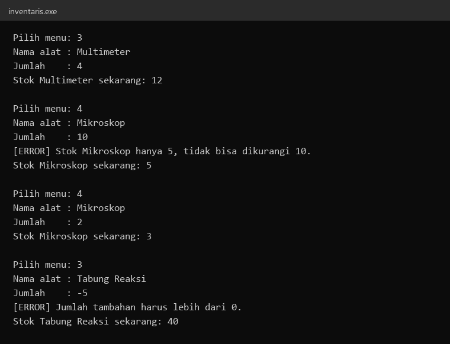
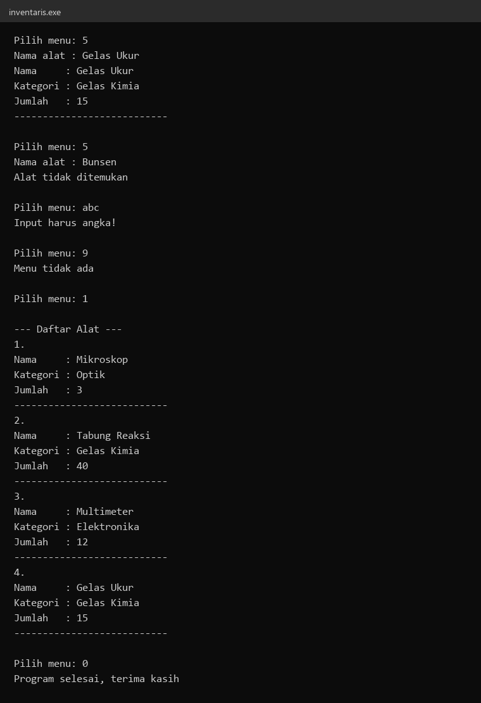

# Praktikum OOP C++ - Inventaris Alat Laboratorium

Tugas kelompok Pertemuan 8 (Object dan Class) - Kelompok 8C

## Anggota Kelompok

| Anggota | Nama | NIM | Peran |
|---------|------|-----|-------|
| A | ... | ... | Lead Programmer (bikin AlatLaboratorium.hpp) |
| B | ... | ... | Implementer (bikin AlatLaboratorium.cpp) |
| C | Sultan Febrian | 26032014076 | Integrator (bikin main.cpp dan merge) |
| D | ... | ... | Tester |
| E | ... | ... | Dokumentator (README dan class diagram) |

## Deskripsi Program

Program ini dibuat untuk mencatat alat-alat di laboratorium seperti mikroskop,
tabung reaksi, dan multimeter. Sebelumnya pencatatan masih manual jadi sering ada
data dobel dan susah ngecek stok.

Fitur program:
- Lihat semua alat
- Tambah alat baru (kalau namanya sudah ada tidak bisa ditambah lagi)
- Tambah jumlah alat
- Kurangi jumlah alat (tidak bisa lebih dari stok)
- Cari info alat berdasarkan nama

Data alat disimpan dalam bentuk object dari class `AlatLaboratorium` dan semua
object nya disimpan di `vector`.

## Cara Menjalankan

1. Clone repo ini
   ```
   git clone https://github.com/truekatsu/Si-kecil-hitam.git
   cd Si-kecil-hitam
   ```
2. Compile (pakai g++)
   ```
   g++ src/main.cpp src/AlatLaboratorium.cpp -o inventaris
   ```
3. Jalankan
   ```
   inventaris
   ```
   kalau di linux/mac pakai `./inventaris`

## Struktur Folder

```
/src
  |- AlatLaboratorium.hpp
  |- AlatLaboratorium.cpp
  |- main.cpp
/docs
  |- class-diagram.png
  |- flowchart.png
  |- laporan-pengujian.md
  |- contoh-output.txt
  |- screenshot-1-daftar-dan-tambah-alat.png
  |- screenshot-2-update-jumlah.png
  |- screenshot-3-info-dan-daftar-akhir.png
/tests
  |- skenario-input.txt
README.md
```

## Penjelasan Class dan Method

### Class Diagram



### Class AlatLaboratorium

Atribut (private, jadi tidak bisa diakses langsung dari main):
- `nama` : nama alat
- `kategori` : jenis/kategori alat
- `jumlah` : jumlah stok alat

Method:
- `AlatLaboratorium(nama, kategori, jumlah)` : constructor untuk mengisi data
  alat waktu object dibuat. Pakai `this->` karena nama parameter sama dengan nama
  atribut.
- `tampilkanInfo()` : menampilkan nama, kategori, dan jumlah alat
- `tambahJumlah(int n)` : menambah stok alat, n harus lebih dari 0
- `kurangiJumlah(int n)` : mengurangi stok alat, tidak bisa kalau n lebih besar
  dari stok
- `getNama()`, `getKategori()`, `getJumlah()` : getter untuk ambil data yang
  private

### main.cpp

- Membuat `vector<AlatLaboratorium>` dan diisi 3 alat awal
- Fungsi `cariAlat()` untuk mencari index alat di vector berdasarkan nama
- Menu pakai perulangan `do while` sampai user pilih 0

## Flowchart



## Screenshot Output Program

Lihat daftar alat dan tambah alat baru



Tambah dan kurangi jumlah alat



Cari info alat dan daftar alat terakhir



Hasil testing lengkap ada di [docs/laporan-pengujian.md](docs/laporan-pengujian.md)
